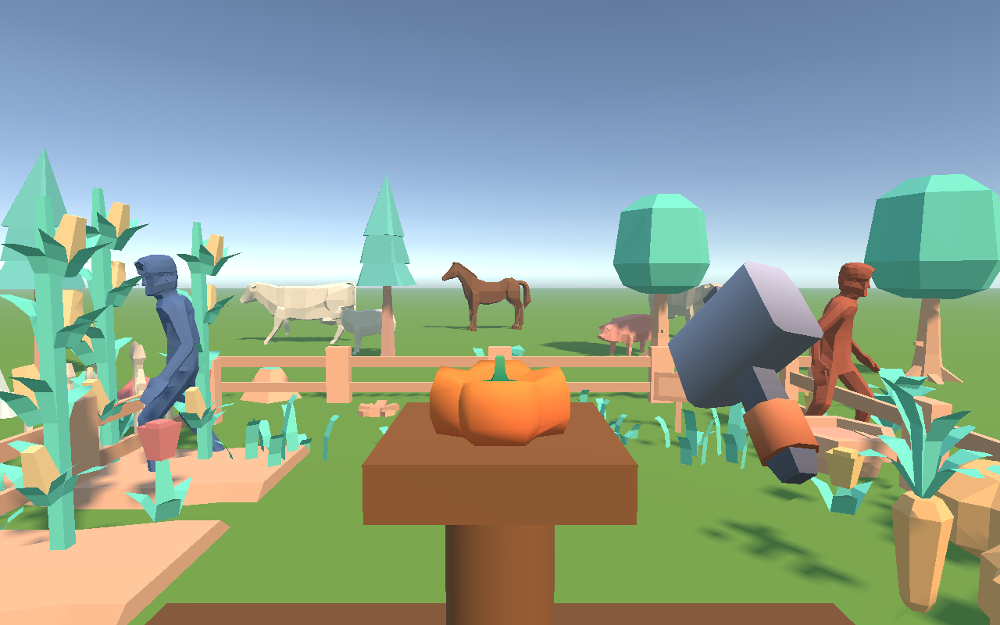
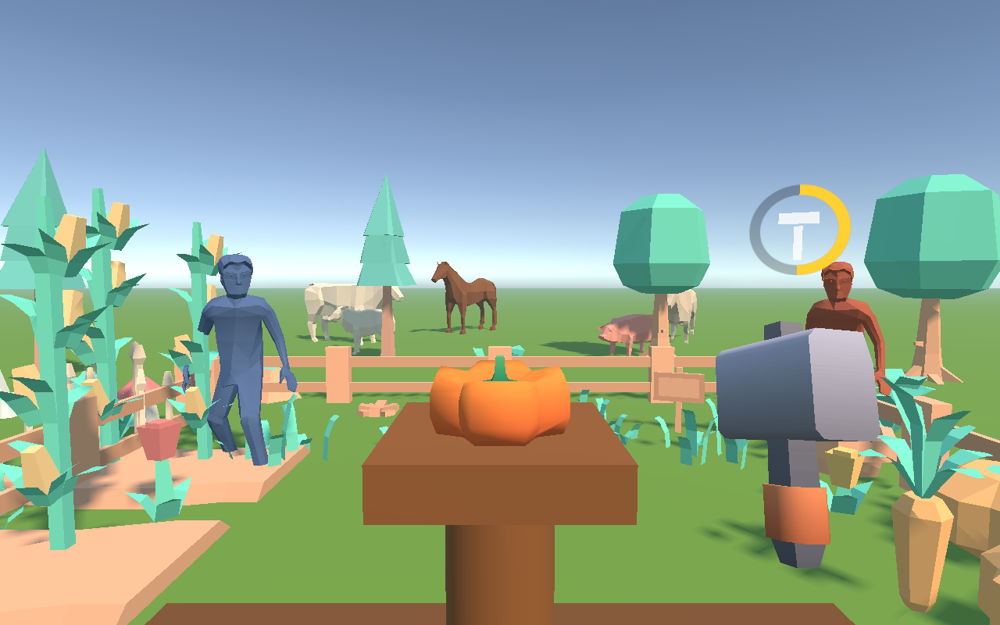
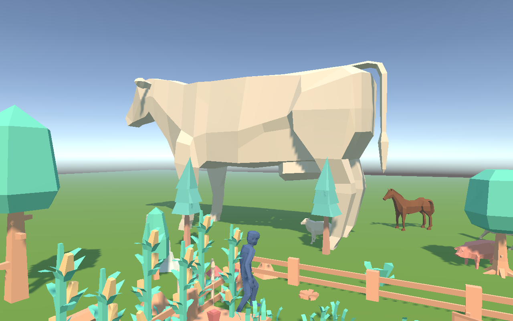

# PicoHammerDemo

一个跑在 PICO 头显上的 **Unity VR 挥锤子 Demo**：右手柄握锤，挥得越快伤害越高，砸爆卡通农场里的南瓜和动物；按住扳机把锤子当雷神之锤甩出去，砸完自动飞回手里。



| 冷却环跟着锤子 | 动物越砸越大，5 倍炸开 |
| --- | --- |
|  |  |

## 玩法

- **近战挥锤**：锤头真的碰到目标、且速度超过阈值才算命中，伤害按锤头速度换算
- **锤爆反馈**：目标挨打会压扁回弹、抖动、闪红并逐渐变大，最后一锤炸成物理碎块，下一个目标自动刷新
- **雷神之锤**：按住右扳机用力甩手，锤子脱手飞出去（最远约 20 米，带自动瞄准），命中后自动飞回，接住有震动
- **能量槽**：扔出去清零，回到手中开始回充，10 秒回满；冷却中只能近战
- **摇杆移动**：左摇杆平移，右摇杆 45° 转向，活动范围限制在农场栅栏内
- **音效全部程序化合成**：没有音频素材文件，开局用代码算波形，零授权风险

## 环境要求

| 项 | 值 |
| --- | --- |
| Unity | 6000.6.7f1（URP） |
| PICO 开发模式 | `picoxr`（PICO 原生 XR，非 OpenXR） |
| 目标设备 | PICO 4 Ultra / PICO Swan |
| 应用包名 | `com.pockpulse.hammerdemo` |
| 主场景 | `Assets/Scenes/SampleScene.unity` |

依赖的 PICO SDK 通过 UPM Git 包引入，需要先装 **Git LFS**（`brew install git-lfs && git lfs install`），否则 PICO SDK 拉不下来会导致编译中断。

## 本地运行

1. 用 Unity 6000.6.7f1 打开工程，等待包解析完成
2. 打开 `Assets/Scenes/SampleScene.unity`
3. 如果画面里的农场或 NPC 缺失，用菜单重建（脚本可重复执行，不会重复叠加）：
   - `PockHammer > Build Farm Scene` —— 农场场景
   - `PockHammer > Add Farm NPCs` —— 牛 / 马 / 羊 / 猪 / 农夫
   - `PockHammer > Build Hammer Model` —— 锤子模型并对齐命中锚点
4. 打包到 Android 后安装到头显；模拟器只能看静态效果，**挥动手感必须真机验收**

## 代码结构

```
Assets/
├── Art/            Kenney + Quaternius 的 CC0 低多边形素材
├── Editor/         一键重建场景 / NPC / 锤子的编辑器脚本
├── Scripts/
│   ├── Input/      输入源接口与挥动数据
│   ├── Gameplay/   锤子跟手、投掷、伤害结算、关卡流程
│   ├── Audio/      程序化音效合成与全局音源
│   ├── World/      农场跟随玩家、NPC 行为
│   ├── UI/         雷神之锤冷却环（代码生成）
│   └── Targets/    可破坏目标与表现层
└── Scenes/         主场景
```

完整的设计取舍和踩坑记录见 [`docs/DEVLOG.md`](docs/DEVLOG.md)，从零搭环境的操作手册见 [`docs/AI-RUNBOOK.md`](docs/AI-RUNBOOK.md)。

## 培训材料

给不写代码的同学的入门材料（不需要 Unity 界面、编程或头显基础）：

| 材料 | 用途 |
| --- | --- |
| [`docs/新人准备手册.md`](docs/新人准备手册.md) | 从一台干净电脑到跑通第一圈的完整步骤（文字版，可在线看） |
| [`docs/training/PICO-VR新人培训.pptx`](docs/training/PICO-VR新人培训.pptx) | 同内容的 18 页培训 PPT（宣讲用，下载后打开） |
| [`docs/AI-RUNBOOK.md`](docs/AI-RUNBOOK.md) | 分阶段操作手册，带验收断言与故障字典 |

## 素材授权

- 场景与道具：[Kenney](https://kenney.nl) Nature Kit / Food Kit / Survival Kit，CC0
- 动物与农夫：[Quaternius](https://quaternius.com)，CC0
- 音效：代码合成，无外部素材

第三方素材明细见 [THIRD-PARTY-NOTICES.md](THIRD-PARTY-NOTICES.md)。

代码以 [MIT License](LICENSE) 开源。